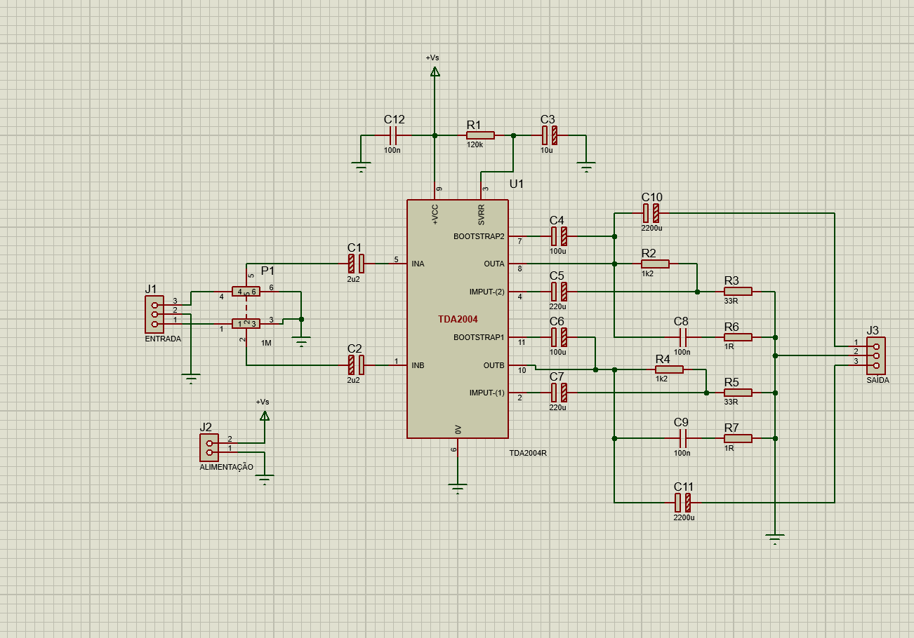

# Amplificador estéreo com TDA2004R

Projeto antigo desenvolvido durante meus estudos de eletrônica, quando eu estava aprendendo a desenhar e montar circuitos amplificadores. O esquema foi elaborado no Proteus e o circuito também foi montado e testado fisicamente.

> **Registro dos testes:** a montagem física foi testada, mas não foram preservados neste projeto valores medidos de tensão, potência, distorção, impedância da carga ou resposta em frequência. Portanto, a indicação “10+10 W” no nome original do arquivo representa a identificação do projeto, não uma potência medida aqui.

## Visão geral

O circuito usa um TDA2004R, amplificador de áudio integrado de dois canais, em uma configuração estéreo. O desenho inclui os componentes de entrada, a rede de realimentação, os capacitores de acoplamento e filtragem, a alimentação e o conector de saída.

Este repositório reúne o arquivo editável do esquema do Proteus e uma imagem de referência. A imagem facilita a visualização sem abrir o projeto; o arquivo `.DSN` contém o esquema editável.

## Arquivos

| Arquivo | Descrição |
| --- | --- |
| [Amplificador 10+10W - AU7.DSN](./Amplificador%2010%2B10W%20-%20AU7.DSN) | Esquema editável do Proteus. |
| [amplificador_tda2004_esquema.png](./amplificador_tda2004_esquema.png) | Captura do esquema para consulta rápida. |

## Componentes identificados no esquema

| Referência | Componente/valor |
| --- | --- |
| U1 | TDA2004R |
| P1 | Potenciômetro duplo, 1 MΩ |
| C1, C2 | 2,2 µF |
| C3 | 10 µF |
| C4, C6 | 100 µF |
| C5, C7 | 220 µF |
| C8, C9, C12 | 100 nF |
| C10, C11 | 2200 µF |
| R1 | 120 kΩ |
| R2, R4 | 1,2 kΩ |
| R3, R5 | 33 Ω |
| R6, R7 | 1 Ω |
| J1 | Entrada de áudio, três pinos |
| J2 | Alimentação, dois pinos |
| J3 | Saída de áudio, três pinos |

Os valores acima foram lidos do material do projeto. Confira os componentes e a pinagem antes de reproduzir a montagem: diferenças de encapsulamento, versão do componente ou biblioteca do Proteus podem alterar a representação.

## Conectores conforme o desenho

- **J1 — entrada:** conector de três vias associado aos dois canais e à referência comum. O sinal passa pelo potenciômetro duplo P1 antes dos capacitores de entrada C1 e C2.
- **J2 — alimentação:** conector de duas vias, desenhado com **+Vs** e **GND**. A tensão de alimentação usada na montagem não está registrada nos arquivos disponíveis.
- **J3 — saída:** conector de três vias para os dois canais e a referência comum. No desenho, as saídas dos canais seguem por redes separadas de acoplamento para o conector.

A numeração dos pinos e a ligação exata devem ser conferidas diretamente no esquema antes da montagem. Não use apenas a descrição deste README para fazer conexões elétricas.

## Como abrir

1. Abra o Proteus.
2. Use **File > Open Project** (ou a opção equivalente da sua versão).
3. Selecione `Amplificador 10+10W - AU7.DSN`.
4. Se a sua versão não abrir diretamente o arquivo, verifique a compatibilidade/importação de projetos de versões anteriores do Proteus.

A versão do Proteus usada para salvar o arquivo não foi anotada.

## Situação do projeto

- [x] Esquema desenhado no Proteus.
- [x] Montagem física realizada e testada.
- [ ] Resultados quantitativos de bancada documentados.
- [ ] Fotos da montagem física incluídas.
- [ ] Especificação da fonte e da carga usada nos testes registrada.

## Contexto e datas

Este é um exercício antigo de aprendizado. Os metadados exportados do projeto indicam criação em **5 de maio de 2025** e modificação em **2 de junho de 2025**. Essas datas descrevem o arquivo de projeto exportado e não comprovam, por si só, quando a montagem física foi feita.

## Aviso

Este material é compartilhado como registro de estudo. O esquema não substitui a folha de dados do TDA2004R nem uma revisão elétrica da montagem. Antes de ligar o circuito, confira polaridade dos capacitores, pinagem do integrado, tensão da fonte, impedância dos alto-falantes, dissipação térmica e continuidade das conexões.

## Licença

Nenhuma licença de reutilização foi definida neste repositório.